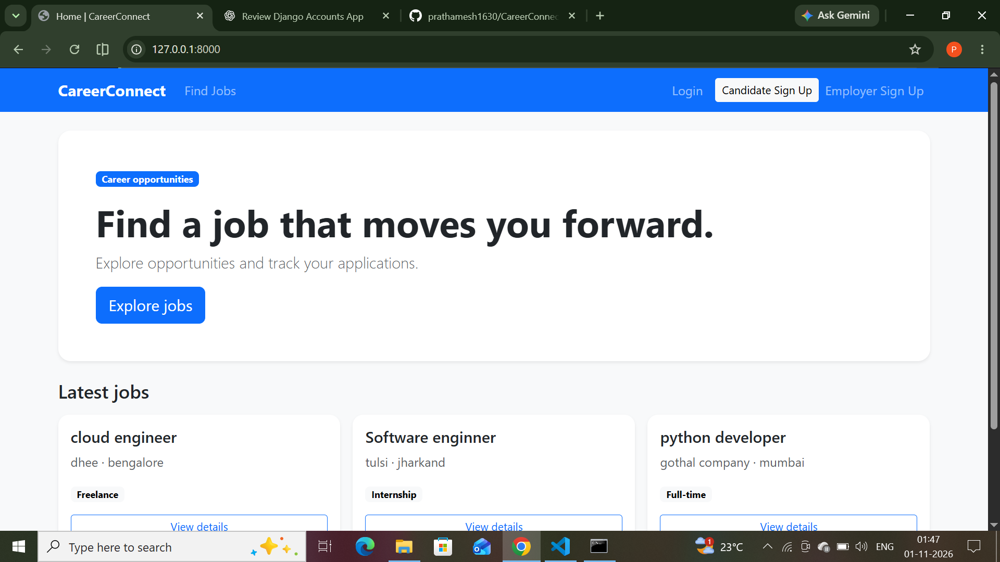
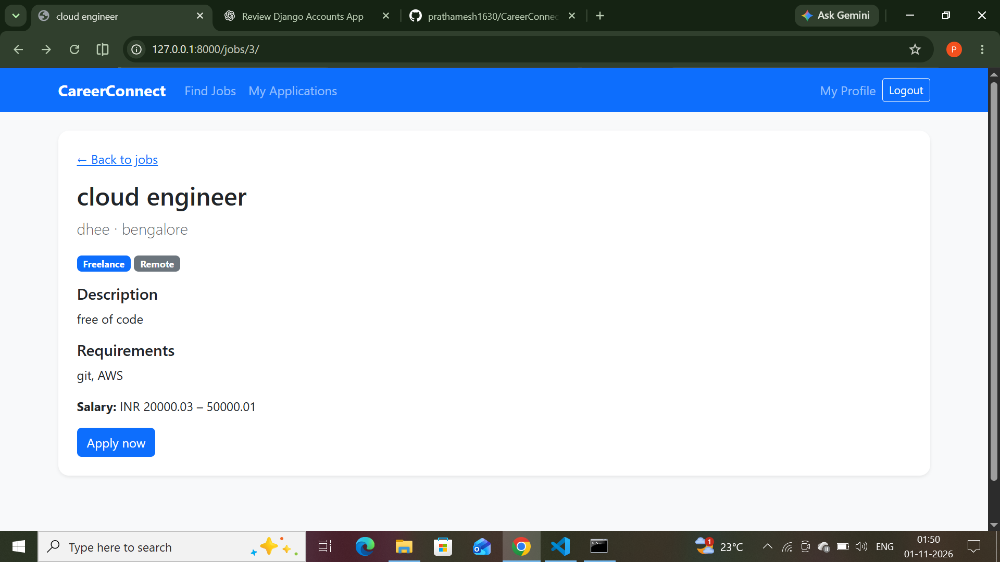
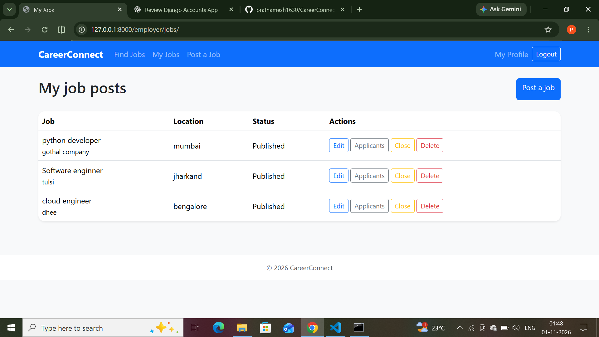
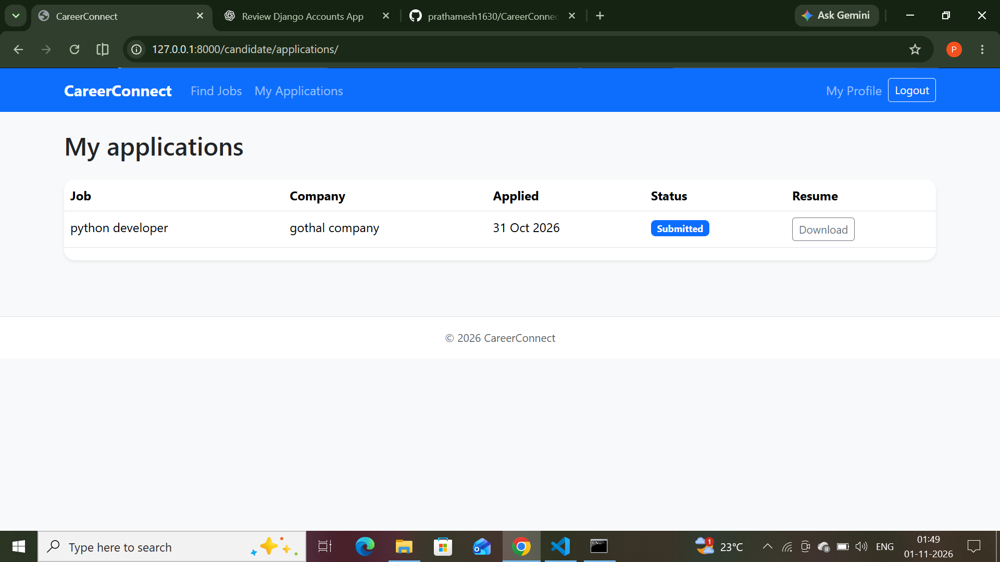

# CareerConnect

CareerConnect is a Django job portal with separate candidate and employer workflows. Candidates can find jobs, maintain a profile, submit a resume with an application, and track its status. Employers can manage their own job posts and review and update applications for those posts.

## Features

- Candidate and employer registration, login, logout, and profile editing.
- Public listing of published jobs, search filters, pagination, and job details.
- Employer job creation, editing, closing, and deletion, scoped to the signed-in employer.
- Candidate applications with PDF or DOCX resumes, a 5 MB size limit, and duplicate application prevention.
- Candidate application history and employer applicant lists with status management.
- Resume downloads restricted to the applicant and the employer who owns the related job.
- Responsive Bootstrap 5 templates and Django messages for workflow feedback.

## Technology

- Python 3.13
- Django 6.0
- SQLite by default (the `DATABASES` setting can be configured for MySQL)
- Bootstrap 5, `django-crispy-forms`, and `crispy-bootstrap5`

## Project structure

```text
accounts/                 Registration, profiles, account tests
applications/             Application workflow, resume validation, tests
jobs/                     Job models, forms, views, and tests
Django_job_portal/         Project settings and root URL configuration
templates/templates/       Project HTML templates
static/css/                Project stylesheet
manage.py                  Django command-line entry point
```

## Data model

- Django's built-in `User` stores login credentials and basic identity fields.
- `accounts.ProfileModel` is a one-to-one extension of `User` with a candidate or employer role and role-specific profile details.
- `jobs.JobModel` belongs to an employer profile and stores job details, salary range, deadline, and publication status.
- `applications.Application` links one candidate profile to one job, stores the resume and application status, and enforces a unique candidate/job pair.

## Setup

From the project directory, create a Python 3.13 virtual environment and install the dependencies used by this project:

```powershell
py -3.13 -m venv .venv
.\.venv\Scripts\Activate.ps1
python -m pip install Django==6.0.7 django-crispy-forms crispy-bootstrap5
```

This repository does not currently include a dependency lock file. Set the environment variables below before starting Django. The `.env.example` file documents their names and placeholder format; Django does not load `.env` files automatically.

### Environment variables

PowerShell example for local development:

```powershell
$env:DJANGO_SECRET_KEY = 'your-local-development-secret'
$env:DJANGO_DEBUG = 'True'
$env:DJANGO_ALLOWED_HOSTS = 'localhost,127.0.0.1,[::1]'
```

Generate a random key with Python when setting up a real deployment:

```powershell
python -c "import secrets; print(secrets.token_urlsafe(50))"
```

Set `DJANGO_SECRET_KEY` to that generated value and set `DJANGO_DEBUG=False` in production. Set `DJANGO_ALLOWED_HOSTS` to the exact host names served by the deployment, comma separated, such as `jobs.example.com`. If the deployment's origin requires it, set `DJANGO_CSRF_TRUSTED_ORIGINS` to comma-separated full origins including the scheme, such as `https://jobs.example.com`. Production mode enables HTTPS redirect and secure session/CSRF cookies; configure valid HTTPS at the hosting layer before deploying.

For local use, `DJANGO_DEBUG` defaults to `True`; if `DJANGO_SECRET_KEY` is unset, Django generates a temporary development key at startup. Local sessions may need to be renewed after restarting the server. Production startup fails if the secret or allowed hosts are missing. Never commit a real `.env` file or secret.

### Database and run commands

The project settings use SQLite at `db.sqlite3` by default. MySQL requires configuring the `DATABASES` setting and an appropriate database driver in the deployment environment.

```powershell
python manage.py migrate
python manage.py runserver
```

Open `http://127.0.0.1:8000/` in a browser. The database migration command creates/updates the local schema; back up a database before applying schema changes to data you care about.

## Automated tests

Tests use Django's test database and Django test client. They create their own users, profiles, jobs, and applications. Resume uploads use a temporary media directory that is removed after tests.

27 tests passed successfully.

The test suite covers account workflows, role and ownership restrictions, job management/search/pagination, application creation and duplicate prevention, document validation, status updates, and protected downloads.

## Screenshots

### Homepage


### Job Details


### Employer Job Management


### Candidate Application Tracking

## Future improvements

- Add deployment-specific database, static file, and media storage configuration.
- Add email verification and password reset delivery.
- Add accessibility checks and browser-level responsive UI testing.
- Add CI to run Django checks and the test suite on each change.
